<div align="center">



# YDL Android

A modern, beautiful Android GUI for [yt-dlp](https://github.com/yt-dlp/yt-dlp).

Download videos and audios from YouTube, TikTok, SoundCloud, Twitter/X and [1000+ websites](https://github.com/yt-dlp/yt-dlp/blob/master/supportedsites.md) with ease.

[](LICENSE)
[](https://github.com/MamadXPirox/ydl-android/releases)
[](https://github.com/MamadXPirox/ydl-android)
[](https://github.com/MamadXPirox/ydl-android/releases)

> Inspired by the desktop app [imsyy/yt-dlp-gui](https://github.com/imsyy/yt-dlp-gui).
> This is an independent Android implementation written in Kotlin + Jetpack Compose.

<!-- Add screenshots here, e.g.:
<p float="left">
  
  
</p>
-->


</div>

## Features

- **Thousands of sites** supported through yt-dlp (YouTube, Instagram, X, Bilibili, and more)
- **Video & playlist parsing** with format, subtitle and chapter info
- **Quality presets** (Best / 2160p … 360p) or **manual** video/audio stream selection
- **Modes:** video + audio, video only, audio only (mp3, m4a, opus, flac, wav…)
- **Subtitles:** uploaded and auto-generated, optional embedding
- **Trim** a time range, record live streams from the start
- **FFmpeg post-processing:** embed metadata / thumbnail / chapters, re-encode, remux, custom FFmpeg args
- **SponsorBlock** segment removal
- **Download queue** with parallel downloads, aria2c multi-connection mode, speed limit, proxy
- **cookies.txt import** for sites that need a login
- **Custom command tab:** run any yt-dlp command, with quick presets
- **In-app yt-dlp updates** (stable / nightly / master)
- **Share to app:** send a link from your browser or any app straight into YDL Android
- Dark / light theme, English and Persian (RTL) UI
- No ads, no tracking, no analytics
- **In-app update check** — Settings → Check for updates

Files are saved to `Downloads/YDL Android`.

## Download

Get the latest APK from the [Releases](../../releases) page.
Requires **Android 10 (API 29)** or newer. Pick the `arm64-v8a` APK for most modern phones, or the `universal` APK if unsure.

## Build from source

```bash
git clone https://github.com/MamadXPirox/ydl-android.git
cd ydl-android
./gradlew assembleDebug
```

The APK is written to `app/build/outputs/apk/debug/`.
Or open the project in Android Studio and press **Run**. JDK 17 is required.

You can also fork the repository and run the **Build APK** GitHub Actions workflow.

## Tips

- If a download fails, update yt-dlp first: **Settings → Update yt-dlp**. Sites change often.
- Browser cookies cannot be read on Android. Export a `cookies.txt` file and import it in Settings.

## How it works

The app bundles Python, yt-dlp, FFmpeg and aria2c through
[youtubedl-android](https://github.com/yausername/youtubedl-android).
`core/ArgsBuilder.kt` turns your selections into yt-dlp arguments, `DownloadManager` runs the queue,
and finished files are copied to the public Downloads folder through MediaStore.

## Disclaimer

This software is a front-end for yt-dlp and is provided for personal use.
You are responsible for complying with the terms of service of the websites you use and with
copyright law in your country. Do not download content you do not have the right to download.
The authors are not affiliated with YouTube, Google, or any other supported website.

## License

Released under the **GNU General Public License v3.0** — see [LICENSE](LICENSE).
This is required because the app bundles [youtubedl-android](https://github.com/yausername/youtubedl-android) (GPL-3.0).
Third-party components and credits are listed in [THIRD_PARTY_NOTICES.md](THIRD_PARTY_NOTICES.md).
